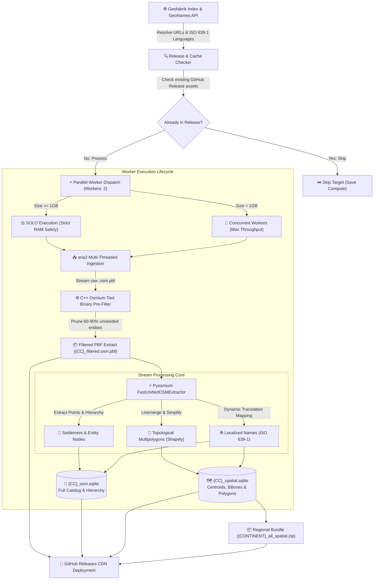

<div align="center">

# 🌍 GeoSpatial-Engine: High-Throughput OpenStreetMap ETL & Spatial Pipeline

**A high-performance, memory-optimized geospatial ETL pipeline transforming multi-gigabyte raw OpenStreetMap `.osm.pbf` extracts into query-optimized, zero-dependency SQLite spatial databases and pre-filtered PBF packages.**

[](LICENSE)
[](https://python.org)
[](https://sqlite.org)
[](https://www.openstreetmap.org/copyright)
[](.github/workflows/harvest_and_release.yml)
[](#-system-architecture)

*Ready-to-query, zero-dependency SQLite spatial databases, compact binary OSM extracts, and unified regional bundles published directly to GitHub Releases.*

[What's Included](#-whats-included) • [Artifact Formats](#-artifact-formats) • [Database Schemas](#-database-schemas) • [SQL Recipes](#-sql-query-recipes) • [Quickstart](#-quickstart--local-development) • [Automation](#-cloud-automation--github-actions)

</div>

---

## ⚡ Overview: What You Get

Working with global OpenStreetMap (OSM) datasets usually requires spinning up heavy PostgreSQL/PostGIS database clusters, installing complex spatial extensions, or downloading multi-gigabyte raw files just to extract city names or administrative boundaries.

**GeoSpatial-Engine** eliminates this complexity by providing clean, pre-built, and self-contained geospatial datasets for every country and territory worldwide. Everything is delivered in lightweight, standalone SQLite databases with pre-computed bounding boxes, simplified GeoJSON polygons, and localized multilingual names—ready for immediate querying in your applications with zero database setup.

### 🌟 What's Included
* **📦 3 Unified Merged Downloads:** Instead of downloading hundreds of individual files, access an entire continent or the entire globe in just **3 consolidated files**:
  1. **`{label}_unified_spatial.zip`** — Single merged spatial database with all settlements, centroids, bounding boxes, and boundaries.
  2. **`{label}_unified_osm.zip`** — Single merged entity catalog with populations, Wikidata QIDs, GeoNames IDs, and multilingual translations.
  3. **`{label}_unified_pbf.zip`** — Bundled archive of all country-level clean, pre-filtered binary `.osm.pbf` extracts.
* **🗺️ Standalone Per-Country SQLite Databases:** Every country has its own `{CC}_spatial.sqlite` and `{CC}_osm.sqlite` with pre-built secondary B-Tree indexes on coordinates, admin levels, Wikidata QIDs, and country codes.
* **🌐 Multilingual Localized Translations:** Official and common names mapped to ISO 639-1 languages (`en`, `es`, `fr`, `zh`, `ar`, `hi`, etc.) for seamless internationalization and UI display.
* **📐 Verified Topological Boundary Polygons:** National and regional administrative boundaries (levels 2–8) assembled into clean `MultiPolygon` GeoJSON geometries with preserved topology.
* **🎯 Pure Zero-Cross-Contamination Filtering:** Combined regional extracts (such as `gcc-states`, `israel-and-palestine`, `haiti-and-domrep`, `senegal-and-gambia`) are cleanly partitioned into their respective individual sovereign country datasets.
* **⚡ Pre-Filtered Reusable PBF Extracts:** Cleaned binary `.osm.pbf` packages reduced by **70%–90%**, ready for immediate use in QGIS, GDAL, osmium, or mobile apps without downloading gigabytes of raw data.

---

## 🏗 System Architecture



---

## 📦 Artifact Formats

Each country target generates production-grade outputs designed for different latency, querying, and reprocessing needs:

| Artifact | Compression / Type | Description |
| :--- | :--- | :--- |
| **`{CC}_filtered.osm.pbf`** *(Core Reusable Asset)* | OSM Protobuf (Deflate) | Cleaned, 70%–90% smaller OSM PBF extract. Reusable by any downstream tool (osmium, pyosmium, GDAL, QGIS) for instant reprocessing without downloading gigabytes of raw data. |
| **`{CC}_spatial.sqlite`** | SQLite 3 (WAL mode) | Spatial database with settlement coordinates, centroids, bounding boxes (`min_lat`, `min_lon`, `max_lat`, `max_lon`), and simplified GeoJSON boundary polygons. |
| **`{CC}_osm.sqlite`** | SQLite 3 (WAL mode) | Comprehensive entity catalog with administrative levels, Wikidata QID, GeoNames ID, population, elevation, and localized multilingual names. |
| **`{CC}_bundle.zip`** | DEFLATE (6) | Optional bundle containing both SQLite databases, reducing download size by **70%–85%**. |
| **`{label}_unified_spatial.zip`** *(1 of 3 Unified)* | DEFLATE (6) | Single merged spatial database containing all countries' settlements, centroids, bounding boxes, and boundaries. |
| **`{label}_unified_osm.zip`** *(2 of 3 Unified)* | DEFLATE (6) | Single merged OSM catalog database containing all countries' entities, metadata, and localized translations. |
| **`{label}_unified_pbf.zip`** *(3 of 3 Unified)* | DEFLATE (6) | Single archive bundling every country's `{CC}_filtered.osm.pbf` extract for 1-click download of all country PBFs. |

---

## 📊 Database Schemas

### 1. `{CC}_osm.sqlite` — Comprehensive Spatial Entities & Hierarchy

Designed for geocoding, entity resolution, administrative graphing, and multi-language lookups.

| Table | Primary Key | Description |
| :--- | :--- | :--- |
| `osm_entities` | `(osm_type, osm_id)` | Spatial points, admin levels (1–8), population, elevation, Wikidata QID, GeoNames ID, timezone, and Wikipedia links. |
| `localized_names` | `(osm_type, osm_id, lang_code)` | Native and international translations mapped to ISO 639-1 codes (`en`, `es`, `fr`, `zh`, etc.). |
| `osm_hierarchy` | `(parent_osm_type, parent_osm_id, child_osm_type, child_osm_id, role)` | Parent-to-child relational graphs mapping administrative memberships and sub-divisions. |

### 2. `{CC}_spatial.sqlite` — Spatial Centroids & Bounding Geometries

Optimized for spatial boundary verification, GIS indexing, bounding-box searches, and perimeter analysis.

| Table | Primary Key | Description |
| :--- | :--- | :--- |
| `spatial_locations` | `(osm_type, osm_id)` | Centroids, settlement classifications, bounding box (`min_lat`, `min_lon`, `max_lat`, `max_lon`), and simplified GeoJSON boundary polygons. |
| `spatial_names` | `(osm_type, osm_id, lang_code)` | Localized settlement and place names for fast localized UI rendering. |
| `spatial_hierarchy` | `(parent_osm_type, parent_osm_id, child_osm_type, child_osm_id, role)` | Administrative inheritance trees for rolling up spatial data across municipal boundaries. |

---

## 🚀 Automated Cloud Builds & Release Pipeline

The datasets are automatically harvested, processed, and published via GitHub Actions using an optimized distributed pipeline:

* **Balanced Parallel Matrix:** Country extracts are partitioned across parallel runners using Longest Processing Time (LPT) bin-packing, processing entire continents in 10–15 minutes.
* **Resume & Targeted Retries:** Skips already-published countries in the active release tag. If a specific country needs reprocessing, you can target that exact release tag (`custom_release_tag`) without rebuilding everything from scratch.
* **Resilient Distribution:** Uploads all country assets in a single batch directly to GitHub Releases with 3-tier exponential backoff retries (10s, 30s, 60s) for robust distribution.
* **Consolidation into 3 Unified Datasets:** Automatically merges individual country databases and PBFs into the 3 consolidated archives (`_unified_spatial.zip`, `_unified_osm.zip`, `_unified_pbf.zip`) for 1-click global or regional access.

---

## 🔍 SQL Query Recipes

### 1. Bounding-Box Spatial Lookup
Find settlements and administrative zones within a target spatial bounding box:

```sql
SELECT osm_type, osm_id, name, place_type, latitude, longitude, population
FROM spatial_locations
WHERE latitude BETWEEN 14.50 AND 14.75
  AND longitude BETWEEN -90.65 AND -90.40
ORDER BY population DESC NULLS LAST;
```

### 2. Multilingual Name Fallback (English &rarr; Local)
Retrieve a location's name in English with automatic fallback to native script:

```sql
SELECT 
    e.osm_id,
    e.name AS default_name,
    COALESCE(n_en.translated_name, e.name) AS display_name,
    e.latitude,
    e.longitude
FROM osm_entities e
LEFT JOIN localized_names n_en 
    ON e.osm_type = n_en.osm_type 
    AND e.osm_id = n_en.osm_id 
    AND n_en.lang_code = 'en'
WHERE e.place_type = 'city'
LIMIT 20;
```

### 3. Administrative Hierarchy Graph Traversal
Discover administrative sub-areas, municipalities, and capital nodes (`admin_centre`) linked to a parent administrative boundary:

```sql
SELECT 
    h.parent_osm_id AS province_relation_id,
    c.name AS administrative_entity,
    c.place_type,
    c.admin_level,
    h.role,
    c.latitude,
    c.longitude
FROM osm_hierarchy h
JOIN osm_entities c 
    ON h.child_osm_type = c.osm_type 
    AND h.child_osm_id = c.osm_id
WHERE h.parent_osm_id = 1521457 -- Target OSM administrative relation ID
ORDER BY c.admin_level ASC, c.name ASC;
```

---

## 🛠 Quickstart & Local Development

### System Prerequisites
* **Python:** 3.10 or later
* **System Utilities:** `osmium-tool` and `aria2`

```bash
# Ubuntu / Debian
sudo apt-get update && sudo apt-get install -y osmium-tool aria2

# macOS (Homebrew)
brew install osmium-tool aria2
```

### Setup
```bash
# Clone the repository
git clone https://github.com/vkk5880/osm-geospatial-engine.git
cd osm-geospatial-engine

# Install Python dependencies
pip install --upgrade pip
pip install -r requirements.txt
```

### Execution

#### Process a Specific Country:
```bash
python main.py --country guatemala
```

#### Process a Continent in Parallel:
```bash
# 2 workers, automatically skipping already-published countries:
python main.py --continent central-america --workers 2
```

#### Process the Entire Globe (Worldwide):
```bash
python main.py --continent all --workers 2
```

#### Force Re-Harvesting of All Countries:
```bash
python main.py --continent central-america --force
```

*Artifacts will be written to the configured exports directory (default: `/tmp/osm_scratch/exports/` or system temp).*

---

## ☁️ Cloud Automation & GitHub Actions

This repository includes a production-grade GitHub Actions workflow (`.github/workflows/harvest_and_release.yml`).

### Running via Workflow Dispatch:
1. Navigate to **Actions** &rarr; **Harvest OSM & Publish Datasets**.
2. Select your target **Continent / Region** (e.g., `central-america`, `europe`, `asia`, `all` for worldwide).
3. Choose whether to **Skip countries already published** (`true` by default for fast, incremental runs).
4. (Optional) Provide a specific country slug (e.g., `monaco`, `iceland`, `guatemala`).
5. Click **Run workflow**.

---

## ℹ️ Global Coverage & Micro-Territory Resolution

* **All Sovereign Nations & Autonomous Territories:** Resolves recursive parent hierarchies to process all country and territory extracts served by Geofabrik worldwide (~191 to ~215 direct files, including Greenland, Puerto Rico, French Polynesia, etc.).
* **Embedded Microstates:** Micro-territories that do not have their own standalone files on Geofabrik (such as Vatican City and San Marino inside Italy, Monaco inside France, and Liechtenstein inside the Alps extract) are extracted as part of their surrounding national PBF files.

---

## 📂 Codebase Layout

```
osm-geospatial-engine/
├── .github/
│   └── workflows/
│       └── harvest_and_release.yml   # Serverless CI/CD release workflow
├── osm_engine/
│   ├── __init__.py                   # Package exports and version metadata
│   ├── config.py                     # Environment variables, tag filters, scratch paths
│   ├── catalog.py                    # Lineage-aware Geofabrik parser & language resolution
│   ├── db.py                         # Spatial SQLite schemas, WAL mode PRAGMAs, and indexing
│   ├── extractor.py                  # Pyosmium streaming handler & Shapely linemerge
│   ├── pipeline.py                   # Ingestion, filtering, streaming, and PBF export
│   ├── router.py                     # Multi-country spatial classification and boundary routing
│   └── merger.py                     # High-performance SQLite database consolidation & PBF bundling
├── main.py                           # Parallel CLI entrypoint with incremental release checks
├── requirements.txt                  # Python dependencies (osmium, requests, shapely)
├── .gitignore                        # Python bytecode, SQLite, and scratch exclusions
├── LICENSE                           # MIT License
└── README.md                         # Portfolio documentation
```

---

## ⚖️ License & Attribution

* **Software License:** [MIT License](LICENSE) &copy; 2026. Free for commercial and non-commercial usage.
* **Data Attribution:** 
  * OpenStreetMap data is licensed under the [Open Database License (ODbL)](https://opendatacommons.org/licenses/odbl/) by the OpenStreetMap Foundation.
  * Extracted country boundaries and PBF files courtesy of [Geofabrik GmbH](https://download.geofabrik.de/).
  * Language reference tables courtesy of [GeoNames](https://www.geonames.org/).
