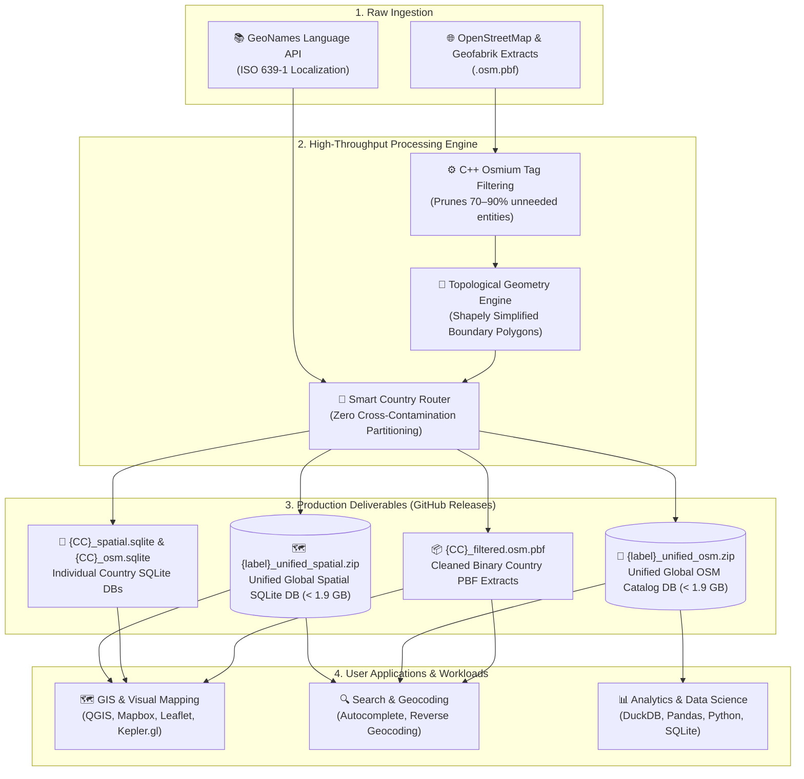

<div align="center">

# 🌍 GeoSpatial-Engine: High-Throughput OpenStreetMap ETL & Spatial Pipeline

**A high-performance, memory-optimized geospatial ETL pipeline transforming multi-gigabyte raw OpenStreetMap `.osm.pbf` extracts into query-optimized, zero-dependency SQLite spatial databases and pre-filtered PBF packages.**

[](LICENSE)
[](https://python.org)
[](https://sqlite.org)
[](https://www.openstreetmap.org/copyright)
[](.github/workflows/harvest_and_release.yml)
[](#-system-architecture)

*Ready-to-query, zero-dependency SQLite spatial databases, compact binary OSM extracts, and unified regional bundles published directly to GitHub Releases.*

[What's Included](#-whats-included) • [Download Datasets](#-downloading-the-datasets) • [Artifact Formats](#-artifact-formats) • [Database Schemas](#-complete-database-schemas--table-definitions) • [Indexes & Performance](#-secondary-b-tree-indexes--query-optimizations) • [SQL Recipes](#-sql-query-recipes)

</div>

---

## ⚡ Overview: 

Working with global OpenStreetMap (OSM) datasets usually requires spinning up heavy PostgreSQL/PostGIS database clusters, installing complex spatial extensions, or downloading multi-gigabyte raw files just to extract city names or administrative boundaries.

**GeoSpatial-Engine** eliminates this complexity by providing clean, pre-built, and self-contained geospatial datasets for every country and territory worldwide. Everything is delivered in lightweight, standalone SQLite databases with pre-computed bounding boxes, simplified GeoJSON polygons, and localized multilingual names—ready for immediate querying in your applications with zero database setup.

### 🌟 What's Included
* **📦 2 Unified Merged Databases:** Instead of downloading hundreds of individual files, access an entire continent or the entire globe in **2 consolidated SQLite databases**:
  1. **`{label}_unified_spatial.zip`** — Single merged spatial database with all settlements, centroids, bounding boxes, and boundaries (< 1.9 GB).
  2. **`{label}_unified_osm.zip`** — Single merged entity catalog with populations, Wikidata QIDs, GeoNames IDs, and multilingual translations (< 1.9 GB).
* **🗺️ Standalone Per-Country SQLite Databases:** Every country has its own `{CC}_spatial.sqlite` and `{CC}_osm.sqlite` with pre-built secondary B-Tree indexes on coordinates, admin levels, Wikidata QIDs, and country codes.
* **🌐 Multilingual Localized Translations:** Official and common names mapped to ISO 639-1 languages (`en`, `es`, `fr`, `zh`, `ar`, `hi`, etc.) for seamless internationalization and UI display.
* **📐 Verified Topological Boundary Polygons:** National and regional administrative boundaries (levels 2–8) assembled into clean `MultiPolygon` GeoJSON geometries with preserved topology.
* **🎯 Pure Zero-Cross-Contamination Filtering:** Combined regional extracts (such as `gcc-states`, `israel-and-palestine`, `haiti-and-domrep`, `senegal-and-gambia`) are cleanly partitioned into their respective individual sovereign country datasets.
* **⚡ Pre-Filtered Reusable PBF Extracts:** Cleaned binary `.osm.pbf` packages reduced by **70%–90%**, ready for immediate use in QGIS, GDAL, osmium, or mobile apps without downloading gigabytes of raw data.

---

## 🏗 System & Data Architecture



---

## 📦 Artifact Formats

Each country target generates production-grade outputs designed for different latency, querying, and reprocessing needs:

| Artifact | Compression / Type | Description |
| :--- | :--- | :--- |
| **`{CC}_filtered.osm.pbf`** *(Core Reusable Asset)* | OSM Protobuf (Deflate) | Cleaned, 70%–90% smaller OSM PBF extract. Reusable by any downstream tool (osmium, GDAL, QGIS) for instant reprocessing. Download all via `gh release download --pattern "*_filtered.osm.pbf"`. |
| **`{CC}_spatial.sqlite`** | SQLite 3 (WAL mode) | Spatial database with settlement coordinates, centroids, bounding boxes (`min_lat`, `min_lon`, `max_lat`, `max_lon`), and simplified GeoJSON boundary polygons. |
| **`{CC}_osm.sqlite`** | SQLite 3 (WAL mode) | Comprehensive entity catalog with administrative levels, Wikidata QID, GeoNames ID, population, elevation, and localized multilingual names. |
| **`{CC}_bundle.zip`** | DEFLATE (6) | Optional bundle containing both SQLite databases, reducing download size by **70%–85%**. |
| **`{label}_unified_spatial.zip`** *(Unified Spatial)* | DEFLATE (6) | Single merged spatial database containing all countries' settlements, centroids, bounding boxes, and boundaries (capped < 1.9 GB). |
| **`{label}_unified_osm.zip`** *(Unified OSM)* | DEFLATE (6) | Single merged OSM catalog database containing all countries' entities, metadata, and localized translations (capped < 1.9 GB). |

---

## 📥 Downloading the Datasets

You can download any individual country database or the unified global archives using direct browser links, command-line tools, or our zero-dependency Python script:

### 1. Direct Download URLs (Zero Setup)
Replace `{CC}` with your target ISO 3166-1 country code (e.g., `US`, `FR`, `DE`, `JP`, `GT`):

| Target Asset | Direct Download Link |
| :--- | :--- |
| **🌍 Worldwide Unified Spatial DB** | [`worldwide_unified_spatial.zip`](https://github.com/vkk5880/osm-geospatial-engine/releases/latest/download/worldwide_unified_spatial.zip) |
| **🌍 Worldwide Unified OSM Catalog** | [`worldwide_unified_osm.zip`](https://github.com/vkk5880/osm-geospatial-engine/releases/latest/download/worldwide_unified_osm.zip) |
| **🗺️ Country Spatial Database** | `https://github.com/vkk5880/osm-geospatial-engine/releases/latest/download/{CC}_spatial.sqlite` |
| **💾 Country OSM Metadata Database** | `https://github.com/vkk5880/osm-geospatial-engine/releases/latest/download/{CC}_osm.sqlite` |
| **📦 Country Full Bundle (Both DBs)** | `https://github.com/vkk5880/osm-geospatial-engine/releases/latest/download/{CC}_bundle.zip` |
| **⚡ Country Filtered Binary PBF** | `https://github.com/vkk5880/osm-geospatial-engine/releases/latest/download/{CC}_filtered.osm.pbf` |

#### One-Liner cURL / Wget Examples:
```bash
# Download the 2 unified global databases:
curl -L -O https://github.com/vkk5880/osm-geospatial-engine/releases/latest/download/worldwide_unified_spatial.zip
curl -L -O https://github.com/vkk5880/osm-geospatial-engine/releases/latest/download/worldwide_unified_osm.zip

# Download a specific country (e.g. Japan):
curl -L -O https://github.com/vkk5880/osm-geospatial-engine/releases/latest/download/JP_bundle.zip
curl -L -O https://github.com/vkk5880/osm-geospatial-engine/releases/latest/download/JP_filtered.osm.pbf
```

---

### 2. Fast Bulk Downloads via GitHub CLI (`gh`)
If you have the [GitHub CLI](https://cli.github.com/) installed, you can download entire groups of files with pattern matching:

```bash
# 1. Download both unified global databases:
gh release download --pattern "*_unified_*.zip"

# 2. Download all country spatial SQLite databases (*_spatial.sqlite):
gh release download --pattern "*_spatial.sqlite"

# 3. Download all cleaned country binary PBF extracts:
gh release download --pattern "*_filtered.osm.pbf"

# 4. Download everything for a single country (e.g. Germany):
gh release download --pattern "DE_*"
```

---

### 3. Automated Downloader Script (`download.py`)
This repository includes a standalone, zero-dependency Python script ([`download.py`](file:///download.py)) with visual download progress:

```bash
# Download the 2 unified global databases:
python download.py --unified

# Download all assets for a specific country (e.g. France):
python download.py --country FR

# Download all country spatial databases:
python download.py --all-spatial

# Download all cleaned binary PBF extracts:
python download.py --all-pbf

# List all available files in the latest release:
python download.py --list
```

---

## 💾 Databases: What's Saved & How to Use Them

Each export produces two complementary databases designed for specific application workloads:

### 1. `{CC}_spatial.sqlite` (or `{label}_unified_spatial.zip`)
* **Core Purpose:** High-speed GIS analysis, bounding-box filtering, geospatial queries, map rendering, and boundary clipping.
* **What is Saved:** Settlement centroids, administrative boundaries with simplified topological GeoJSON polygons (`polygon_geojson`), bounding boxes (`bbox_min_lat`, `bbox_min_lon`, `bbox_max_lat`, `bbox_max_lon`), and spatial inheritance links.
* **Best Used For:**
  * Spatial lookups (e.g. *“Find all cities within this bounding box”* or *“Find places within 25 km”*).
  * Rendering national, provincial, and district boundaries on Leaflet, Mapbox, Deck.gl, or QGIS directly from SQLite.
  * Spatial joins and reverse geocoding without spinning up a heavy PostGIS instance.

### 2. `{CC}_osm.sqlite` (or `{label}_unified_osm.zip`)
* **Core Purpose:** Search autocomplete, entity resolution, multilingual internationalization (i18n), and administrative graph traversal.
* **What is Saved:** Comprehensive entity attributes including census populations, elevations, postal codes, Wikidata QIDs, GeoNames IDs, IANA timezones, Wikipedia article titles, official/common multilingual translations (ISO 639-1), and parent-child administrative hierarchies.
* **Best Used For:**
  * Geocoding engines and search auto-completion with localized name fallbacks (e.g. *“Show city names in Spanish or Japanese”*).
  * Data enrichment: linking OSM features to Wikidata knowledge graphs or GeoNames IDs.
  * Demographic analysis (e.g. *“Total population of all level-6 districts in France”*).
  * Relational graph walks (e.g. *“List all municipal sub-areas belonging to a province relation”*).

---

## 📊 Complete Database Schemas & Table Definitions

### Schema 1: Spatial Database (`spatial_locations`, `spatial_names`, `spatial_hierarchy`)

#### Table: `spatial_locations`
Stores physical coordinates, bounding geometries, and settlement classifications.

| Column | Type | Nullable? | Description & Example |
| :--- | :--- | :---: | :--- |
| `osm_type` | `TEXT` | ❌ No | OSM element type: `'node'`, `'way'`, or `'relation'` |
| `osm_id` | `INTEGER` | ❌ No | Unique numeric OpenStreetMap identifier (e.g. `240109189`) |
| `geoname_id` | `INTEGER` | ✔️ Yes | Matched GeoNames database ID if mapped in OSM (e.g. `3598132`) |
| `wikidata_qid` | `TEXT` | ✔️ Yes | Wikidata entity identifier (e.g. `'Q60'`, `'Q84'`) |
| `name` | `TEXT` | ✔️ Yes | Primary native name of the location (e.g. `'Guatemala City'`) |
| `country_code` | `TEXT` | ❌ No | ISO 3166-1 alpha-2 sovereign country code (e.g. `'GT'`, `'FR'`, `'US'`) |
| `place_type` | `TEXT` | ✔️ Yes | Settlement/feature classification: `'city'`, `'town'`, `'village'`, `'administrative'`, etc. |
| `admin_level` | `INTEGER` | ✔️ Yes | OSM administrative depth (2 = National, 4 = State/Province, 6 = County/District, 8 = Municipality) |
| `latitude` | `REAL` | ❌ No | WGS-84 decimal latitude of the centroid / representative point (e.g. `14.634915`) |
| `longitude` | `REAL` | ❌ No | WGS-84 decimal longitude of the centroid / representative point (e.g. `-90.506882`) |
| `bbox_min_lat` | `REAL` | ✔️ Yes | Southernmost latitude coordinate of the bounding box |
| `bbox_min_lon` | `REAL` | ✔️ Yes | Westernmost longitude coordinate of the bounding box |
| `bbox_max_lat` | `REAL` | ✔️ Yes | Northernmost latitude coordinate of the bounding box |
| `bbox_max_lon` | `REAL` | ✔️ Yes | Easternmost longitude coordinate of the bounding box |
| `polygon_geojson`| `TEXT` | ✔️ Yes | Complete simplified GeoJSON `Polygon` or `MultiPolygon` string with verified topology |
| `population` | `INTEGER` | ✔️ Yes | Official census / population count parsed into a clean integer |
| `elevation` | `REAL` | ✔️ Yes | Elevation in meters above sea level (`ele` tag) |
| `timezone` | `TEXT` | ✔️ Yes | IANA timezone identifier (e.g. `'America/Guatemala'`) |

> **Primary Key:** `(osm_type, osm_id)`

#### Table: `spatial_names`
Localized settlement and boundary names for multi-language display.

| Column | Type | Nullable? | Description |
| :--- | :--- | :---: | :--- |
| `osm_type` | `TEXT` | ❌ No | OSM element type (`'node'`, `'way'`, `'relation'`) |
| `osm_id` | `INTEGER` | ❌ No | OSM element ID matching `spatial_locations` |
| `lang_code` | `TEXT` | ❌ No | ISO 639-1 language code (e.g. `'en'`, `'es'`, `'fr'`, `'zh'`, `'ar'`, `'hi'`) |
| `name_type` | `TEXT` | ❌ No | Translation classification: `'common'`, `'official'`, or `'international'` |
| `translated_name`| `TEXT` | ❌ No | Translated location name in the specified language/script |

> **Primary Key:** `(osm_type, osm_id, lang_code, name_type)`

#### Table: `spatial_hierarchy`
Administrative parent-child relational tree for spatial boundaries.

| Column | Type | Nullable? | Description |
| :--- | :--- | :---: | :--- |
| `parent_osm_type` | `TEXT` | ❌ No | Parent element type (typically `'relation'`) |
| `parent_osm_id` | `INTEGER` | ❌ No | Parent OSM relation ID (e.g. province or department ID) |
| `child_osm_type` | `TEXT` | ❌ No | Child element type (`'node'`, `'way'`, or `'relation'`) |
| `child_osm_id` | `INTEGER` | ❌ No | Child OSM ID (e.g. municipality, town, or capital node) |
| `role` | `TEXT` | ❌ No | Relationship role: `'admin_centre'`, `'label'`, `'subarea'`, `'member'` |

> **Primary Key:** `(parent_osm_type, parent_osm_id, child_osm_type, child_osm_id, role)`

---

### Schema 2: OSM Catalog Database (`osm_entities`, `localized_names`, `osm_hierarchy`)

#### Table: `osm_entities`
Primary metadata catalog for entity linking, demographics, and geocoding.

| Column | Type | Nullable? | Description & Example |
| :--- | :--- | :---: | :--- |
| `osm_type` | `TEXT` | ❌ No | OSM element type: `'node'`, `'way'`, or `'relation'` |
| `osm_id` | `INTEGER` | ❌ No | Unique numeric OpenStreetMap identifier |
| `geoname_id` | `INTEGER` | ✔️ Yes | Matched GeoNames database ID (e.g. `3598132`) |
| `wikidata_qid` | `TEXT` | ✔️ Yes | Wikidata entity identifier (e.g. `'Q60'`) |
| `name` | `TEXT` | ✔️ Yes | Default primary/native name |
| `country_code` | `TEXT` | ❌ No | ISO 3166-1 alpha-2 sovereign country code (e.g. `'GT'`, `'JP'`) |
| `latitude` | `REAL` | ✔️ Yes | WGS-84 decimal latitude |
| `longitude` | `REAL` | ✔️ Yes | WGS-84 decimal longitude |
| `place_type` | `TEXT` | ✔️ Yes | Settlement/feature type (`'city'`, `'town'`, `'village'`, `'hamlet'`, etc.) |
| `admin_level` | `INTEGER` | ✔️ Yes | Administrative level depth (1 to 8) |
| `population` | `INTEGER` | ✔️ Yes | Clean integer population count |
| `elevation` | `REAL` | ✔️ Yes | Elevation in meters above sea level |
| `postal_code` | `TEXT` | ✔️ Yes | Postal / ZIP code (from `postal_code` or `addr:postcode`) |
| `timezone` | `TEXT` | ✔️ Yes | IANA timezone string |
| `wikipedia` | `TEXT` | ✔️ Yes | Wikipedia article identifier (e.g. `'en:Guatemala City'`) |

> **Primary Key:** `(osm_type, osm_id)`

#### Table: `localized_names`
Complete multilingual name translations mapped to ISO 639-1 language codes.

| Column | Type | Nullable? | Description |
| :--- | :--- | :---: | :--- |
| `osm_type` | `TEXT` | ❌ No | OSM element type (`'node'`, `'way'`, `'relation'`) |
| `osm_id` | `INTEGER` | ❌ No | OSM element ID matching `osm_entities` |
| `lang_code` | `TEXT` | ❌ No | ISO 639-1 language code (`'en'`, `'es'`, `'fr'`, `'de'`, `'zh'`, `'ru'`, `'ja'`, etc.) |
| `name_type` | `TEXT` | ❌ No | Translation classification: `'common'`, `'official'`, or `'international'` |
| `translated_name`| `TEXT` | ❌ No | Translated place name string |

> **Primary Key:** `(osm_type, osm_id, lang_code, name_type)`

#### Table: `osm_hierarchy`
Administrative parent-to-child relational graphs mapping subdivisions and administrative centres.

| Column | Type | Nullable? | Description |
| :--- | :--- | :---: | :--- |
| `parent_osm_type` | `TEXT` | ❌ No | Parent element type (typically `'relation'`) |
| `parent_osm_id` | `INTEGER` | ❌ No | Parent OSM relation ID |
| `child_osm_type` | `TEXT` | ❌ No | Child element type (`'node'`, `'way'`, `'relation'`) |
| `child_osm_id` | `INTEGER` | ❌ No | Child OSM ID |
| `role` | `TEXT` | ❌ No | Member role (`'admin_centre'`, `'label'`, `'subarea'`, `'member'`) |

> **Primary Key:** `(parent_osm_type, parent_osm_id, child_osm_type, child_osm_id, role)`

---

## ⚡ Secondary B-Tree Indexes & Query Optimizations

Both databases are pre-indexed with high-performance B-Tree secondary indexes to enable sub-millisecond queries even on millions of rows:

| Database | Index Name | Indexed Columns | Optimized Query Pattern |
| :--- | :--- | :--- | :--- |
| **Spatial** | `idx_s_coords` | `(latitude, longitude)` | Bounding-box queries, radial radius scans, and nearest-neighbor distance searches. |
| **Spatial** | `idx_s_cc` | `(country_code)` | Instant country partitioning and filtering in the global unified database. |
| **Spatial** | `idx_s_admin` | `(admin_level)` | Instant retrieval of national boundaries (`level 2`), states (`level 4`), and counties (`level 6`). |
| **Spatial** | `idx_s_qid` | `(wikidata_qid)` | Instant zero-cost joins between spatial locations and Wikidata knowledge graphs. |
| **Spatial** | `idx_s_gid` | `(geoname_id)` | O(1) matching with GeoNames geospatial datasets. |
| **Spatial** | `idx_s_h_parent` | `(parent_osm_type, parent_osm_id)` | Top-down administrative hierarchy traversal (find all municipalities in a state). |
| **Spatial** | `idx_s_h_child` | `(child_osm_type, child_osm_id)` | Bottom-up boundary lookup (find parent province/nation of a specific town). |
| **OSM Catalog** | `idx_raw_cc` | `(country_code)` | Fast country-level slicing in the unified OSM database. |
| **OSM Catalog** | `idx_raw_qid` | `(wikidata_qid)` | Instant lookups by Wikidata QID across all entities. |
| **OSM Catalog** | `idx_raw_gid` | `(geoname_id)` | Instant lookups by GeoNames ID across all entities. |
| **OSM Catalog** | `idx_raw_h_parent` | `(parent_osm_type, parent_osm_id)` | Fast relational tree traversal across administrative divisions. |
| **OSM Catalog** | `idx_raw_h_child` | `(child_osm_type, child_osm_id)` | Reverse lookup from child entities to enclosing parent relations. |

> **SQLite Engine Pragmas:** Each database is compiled using Write-Ahead Logging (`WAL`), static memory temp storage (`temp_store = MEMORY`), and 64 MB working page caches (`cache_size = -64000`), finalized with `PRAGMA optimize;` for static distribution.

---

## 🚀 Automated Cloud Builds & Release Pipeline

The datasets are automatically harvested, processed, and published via GitHub Actions using an optimized distributed pipeline:

* **Balanced Parallel Matrix:** Country extracts are partitioned across parallel runners using Longest Processing Time (LPT) bin-packing, processing entire continents in 10–15 minutes.
* **Resume & Targeted Retries:** Skips already-published countries in the active release tag. If a specific country needs reprocessing, you can target that exact release tag (`custom_release_tag`) without rebuilding everything from scratch.
* **Resilient Distribution:** Uploads all country assets in a single batch directly to GitHub Releases with 3-tier exponential backoff retries (10s, 30s, 60s) for robust distribution.
* **Consolidation into 2 Unified Datasets:** Automatically merges individual country databases into 2 consolidated archives (`_unified_spatial.zip` and `_unified_osm.zip` capped < 1.9 GB) for 1-click global or regional access.

---

## 🔍 SQL Query Recipes

### 1. Bounding-Box Spatial Lookup
Find settlements and administrative zones within a target spatial bounding box:

```sql
SELECT osm_type, osm_id, name, place_type, latitude, longitude, population
FROM spatial_locations
WHERE latitude BETWEEN 14.50 AND 14.75
  AND longitude BETWEEN -90.65 AND -90.40
ORDER BY population DESC NULLS LAST;
```

### 2. Multilingual Name Fallback (English &rarr; Local)
Retrieve a location's name in English with automatic fallback to native script:

```sql
SELECT 
    e.osm_id,
    e.name AS default_name,
    COALESCE(n_en.translated_name, e.name) AS display_name,
    e.latitude,
    e.longitude
FROM osm_entities e
LEFT JOIN localized_names n_en 
    ON e.osm_type = n_en.osm_type 
    AND e.osm_id = n_en.osm_id 
    AND n_en.lang_code = 'en'
WHERE e.place_type = 'city'
LIMIT 20;
```

### 3. Administrative Hierarchy Graph Traversal
Discover administrative sub-areas, municipalities, and capital nodes (`admin_centre`) linked to a parent administrative boundary:

```sql
SELECT 
    h.parent_osm_id AS province_relation_id,
    c.name AS administrative_entity,
    c.place_type,
    c.admin_level,
    h.role,
    c.latitude,
    c.longitude
FROM osm_hierarchy h
JOIN osm_entities c 
    ON h.child_osm_type = c.osm_type 
    AND h.child_osm_id = c.osm_id
WHERE h.parent_osm_id = 1521457 -- Target OSM administrative relation ID
ORDER BY c.admin_level ASC, c.name ASC;
```

---

## 🛠 Quickstart & Local Development

### System Prerequisites
* **Python:** 3.10 or later
* **System Utilities:** `osmium-tool` and `aria2`

```bash
# Ubuntu / Debian
sudo apt-get update && sudo apt-get install -y osmium-tool aria2

# macOS (Homebrew)
brew install osmium-tool aria2
```

### Setup
```bash
# Clone the repository
git clone https://github.com/vkk5880/osm-geospatial-engine.git
cd osm-geospatial-engine

# Install Python dependencies
pip install --upgrade pip
pip install -r requirements.txt
```

### Execution

#### Process a Specific Country:
```bash
python main.py --country guatemala
```

#### Process a Continent in Parallel:
```bash
# 2 workers, automatically skipping already-published countries:
python main.py --continent central-america --workers 2
```

#### Process the Entire Globe (Worldwide):
```bash
python main.py --continent all --workers 2
```

#### Force Re-Harvesting of All Countries:
```bash
python main.py --continent central-america --force
```

*Artifacts will be written to the configured exports directory (default: `/tmp/osm_scratch/exports/` or system temp).*

---

## ☁️ Cloud Automation & GitHub Actions

This repository includes a production-grade GitHub Actions workflow (`.github/workflows/harvest_and_release.yml`).

### Running via Workflow Dispatch:
1. Navigate to **Actions** &rarr; **Harvest OSM & Publish Datasets**.
2. Select your target **Continent / Region** (e.g., `central-america`, `europe`, `asia`, `all` for worldwide).
3. Choose whether to **Skip countries already published** (`true` by default for fast, incremental runs).
4. (Optional) Provide a specific country slug (e.g., `monaco`, `iceland`, `guatemala`).
5. Click **Run workflow**.

---

## ℹ️ Global Coverage & Micro-Territory Resolution

* **All Sovereign Nations & Autonomous Territories:** Resolves recursive parent hierarchies to process all country and territory extracts served by Geofabrik worldwide (~191 to ~215 direct files, including Greenland, Puerto Rico, French Polynesia, etc.).
* **Embedded Microstates:** Micro-territories that do not have their own standalone files on Geofabrik (such as Vatican City and San Marino inside Italy, Monaco inside France, and Liechtenstein inside the Alps extract) are extracted as part of their surrounding national PBF files.


---

## ⚖️ License & Attribution

* **Software License:** [MIT License](LICENSE) &copy; 2026. Free for commercial and non-commercial usage.
* **Data Attribution:** 
  * OpenStreetMap data is licensed under the [Open Database License (ODbL)](https://opendatacommons.org/licenses/odbl/) by the OpenStreetMap Foundation.
  * Extracted country boundaries and PBF files courtesy of [Geofabrik GmbH](https://download.geofabrik.de/).
  * Language reference tables courtesy of [GeoNames](https://www.geonames.org/).
