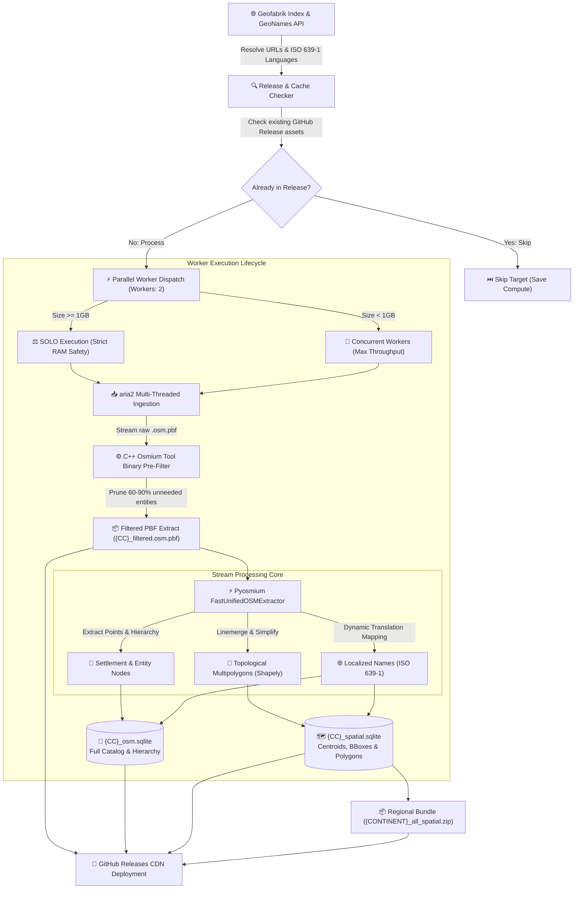

<div align="center">

# 🌍 GeoSpatial-Engine: High-Throughput OpenStreetMap ETL & Spatial Pipeline

**A high-performance, memory-optimized geospatial ETL pipeline transforming multi-gigabyte raw OpenStreetMap `.osm.pbf` extracts into query-optimized, zero-dependency SQLite spatial databases and pre-filtered PBF packages.**

[](LICENSE)
[](https://python.org)
[](https://sqlite.org)
[](https://www.openstreetmap.org/copyright)
[](.github/workflows/harvest_and_release.yml)
[](#-system-architecture)

*Engineered for resource-constrained CI/CD runners (2 vCPUs / 7 GB RAM) to stream millions of spatial nodes, reconstruct topological boundary polygons, and publish production datasets directly to GitHub Releases.*

[Key Features](#-key-features) • [System Architecture](#-system-architecture) • [Artifact Formats](#-artifact-formats) • [Database Schemas](#-database-schemas) • [Parallel Architecture](#-parallel-processing--resource-budgeting) • [Query Recipes](#-sql-query-recipes) • [Quickstart](#-quickstart--local-development) • [GitHub Actions CI/CD](#-cloud-automation--github-actions)

</div>

---

## ⚡ Overview & Why GeoSpatial-Engine?

Traditional geospatial extract-transform-load (ETL) pipelines processing global OpenStreetMap (OSM) datasets typically require enterprise PostGIS clusters, high-memory virtual machines (32GB+ RAM), and complex spatial indexing daemons.

**GeoSpatial-Engine** eliminates this operational overhead by providing a streamlined, **zero-database-dependency** pipeline designed to execute inside standard serverless environments (such as GitHub Actions `ubuntu-latest` runners). It pre-filters binary protocol buffers via C++ bindings, reconstructs fragmented topological boundaries in a single stream, and outputs production-ready SQLite databases with Write-Ahead Logging (`WAL`), pre-calculated bounding boxes, and reusable pre-filtered PBF extracts.

### 🌟 Key Highlights
* **Binary-Level Pre-Filtering & PBF Preservation:** Integrates `osmium-tool` expressions at the C++ binary level to isolate administrative boundaries and settlement nodes prior to Python ingestion—reducing data overhead by **60% to 90%** and preserving `{CC}_filtered.osm.pbf` for fast downstream processing.
* **Dual-Core Parallel Worker Pool:** Automatically scales across 2 parallel workers for standard country extracts while dynamically enforcing sequential (SOLO) execution on multi-gigabyte extracts (>= 1024 MB) to eliminate Out-Of-Memory (OOM) risks.
* **Zero-Leak Streaming Parser:** Employs `pyosmium.SimpleHandler` with low-overhead C++ node iterators, enabling processing of multi-gigabyte PBF extracts without building bloated in-memory element trees.
* **Topological Boundary Reconstitution:** Assembles disjointed outer boundary ways into verified `MultiPolygon` geometries using `shapely.ops.linemerge` and topology-preserving Douglas-Peucker simplification (`0.002°` tolerance).
* **High-Throughput SQLite Storage Engine:** Connects SQLite with high-write pragmas (`PRAGMA journal_mode = WAL`, `PRAGMA synchronous = OFF`, 64MB memory caches) and defers B-Tree indexing until after bulk streaming ingestion.
* **Complete Global & Autonomous Territory Coverage:** Resolves recursive parent hierarchies to process all sovereign nations and autonomous territories (e.g. Greenland, Puerto Rico, French overseas departments).
* **Incremental Release Harvesting:** Automatically detects existing assets in GitHub Releases to skip already-harvested countries—allowing entire continents or the entire globe to be processed incrementally across workflow runs.
* **Autonomous Cloud Distribution:** Completely decoupled from external storage drives or cloud buckets; streams artifacts directly to **GitHub Releases CDN** for frictionless downstream consumption.

---

## 🏗 System Architecture



---

## 📦 Artifact Formats

Each country target generates production-grade outputs designed for different latency, querying, and reprocessing needs:

| Artifact | Compression / Type | Description |
| :--- | :--- | :--- |
| **`{CC}_filtered.osm.pbf`** *(Core Reusable Asset)* | OSM Protobuf (Deflate) | Cleaned, 70%–90% smaller OSM PBF extract. Reusable by any downstream tool (osmium, pyosmium, GDAL, QGIS) for instant reprocessing without downloading gigabytes of raw data. |
| **`{CC}_spatial.sqlite`** | SQLite 3 (WAL mode) | Spatial database with settlement coordinates, centroids, bounding boxes (`min_lat`, `min_lon`, `max_lat`, `max_lon`), and simplified GeoJSON boundary polygons. |
| **`{CC}_osm.sqlite`** | SQLite 3 (WAL mode) | Comprehensive entity catalog with administrative levels, Wikidata QID, GeoNames ID, population, elevation, and localized multilingual names. |
| **`{CC}_bundle.zip`** | DEFLATE (6) | Optional bundle containing both SQLite databases, reducing download size by **70%–85%**. |
| **`{CONTINENT}_all_spatial.zip`** | DEFLATE (6) | Combined bundle containing every country spatial database across an entire continent for 1-click regional access. |

---

## 📊 Database Schemas

### 1. `{CC}_osm.sqlite` — Comprehensive Spatial Entities & Hierarchy

Designed for geocoding, entity resolution, administrative graphing, and multi-language lookups.

| Table | Primary Key | Description |
| :--- | :--- | :--- |
| `osm_entities` | `(osm_type, osm_id)` | Spatial points, admin levels (1–8), population, elevation, Wikidata QID, GeoNames ID, timezone, and Wikipedia links. |
| `localized_names` | `(osm_type, osm_id, lang_code)` | Native and international translations mapped to ISO 639-1 codes (`en`, `es`, `fr`, `zh`, etc.). |
| `osm_hierarchy` | `(parent_osm_type, parent_osm_id, child_osm_type, child_osm_id, role)` | Parent-to-child relational graphs mapping administrative memberships and sub-divisions. |

### 2. `{CC}_spatial.sqlite` — Spatial Centroids & Bounding Geometries

Optimized for spatial boundary verification, GIS indexing, bounding-box searches, and perimeter analysis.

| Table | Primary Key | Description |
| :--- | :--- | :--- |
| `spatial_locations` | `(osm_type, osm_id)` | Centroids, settlement classifications, bounding box (`min_lat`, `min_lon`, `max_lat`, `max_lon`), and simplified GeoJSON boundary polygons. |
| `spatial_names` | `(osm_type, osm_id, lang_code)` | Localized settlement and place names for fast localized UI rendering. |
| `spatial_hierarchy` | `(parent_osm_type, parent_osm_id, child_osm_type, child_osm_id, role)` | Administrative inheritance trees for rolling up spatial data across municipal boundaries. |

---

## ⚡ Two-Tier Parallel Architecture (Up to 20 Concurrent Cloud Runners)

To process massive regional datasets (e.g., 45 countries in Europe or 191+ worldwide) in minutes rather than hours, the engine implements a **two-tier parallel processing architecture**:

### Tier 1: Cloud-Level Runner Swarm (GitHub Actions Matrix)
* **Dynamic Smart Matrix Planning:** The `plan-harvest` job inspects pending targets, checks existing release assets, and partitions the queue across up to **15 concurrent GitHub runners by default** (configurable up to 20).
* **Smart Batch Packing (~4 Countries per Runner):** Standard country extracts (< 500 MB) are automatically binned into batches of ~4 countries per runner. For example, 20 countries start **5 runner jobs** instead of 20, and 11 countries (Central America) start **3 runner jobs**—preventing wasted runner jobs while balancing total payload evenly across runners.
* **Conflict-Free Asset Uploads:** The release is pre-created by the planning job, allowing all 20 runner jobs to execute concurrently and stream individual country assets (`{CC}_filtered.osm.pbf`, `{CC}_osm.sqlite`, `{CC}_spatial.sqlite`) into the release via `gh release upload --clobber` without race conditions.
* **Massive Speedup:** Europe (45 countries) completes in **~10–15 minutes** instead of ~3.5 hours on a single runner.

### Tier 2: Runner-Level Dual Concurrency (`--workers 2`)
* **100% vCPU Utilization:** Each runner utilizes standard GitHub 2-vCPU hardware with 2 worker processes running concurrently. Total swarm throughput reaches up to **40 vCPUs** crunching spatial data simultaneously.
* **Dynamic Memory Gating (`SOLO_THRESHOLD_MB = 1024 MB`):** Multi-gigabyte extracts (e.g., France, Germany, Brazil, Russia) automatically run sequentially (SOLO) to ensure the full 7 GB memory headroom is available, eliminating OOM failures.

---

## 🔍 SQL Query Recipes

### 1. Bounding-Box Spatial Lookup
Find settlements and administrative zones within a target spatial bounding box:

```sql
SELECT osm_type, osm_id, name, place_type, latitude, longitude, population
FROM spatial_locations
WHERE latitude BETWEEN 14.50 AND 14.75
  AND longitude BETWEEN -90.65 AND -90.40
ORDER BY population DESC NULLS LAST;
```

### 2. Multilingual Name Fallback (English &rarr; Local)
Retrieve a location's name in English with automatic fallback to native script:

```sql
SELECT 
    e.osm_id,
    e.name AS default_name,
    COALESCE(n_en.translated_name, e.name) AS display_name,
    e.latitude,
    e.longitude
FROM osm_entities e
LEFT JOIN localized_names n_en 
    ON e.osm_type = n_en.osm_type 
    AND e.osm_id = n_en.osm_id 
    AND n_en.lang_code = 'en'
WHERE e.place_type = 'city'
LIMIT 20;
```

### 3. Administrative Hierarchy Graph Traversal
Discover administrative sub-areas, municipalities, and capital nodes (`admin_centre`) linked to a parent administrative boundary:

```sql
SELECT 
    h.parent_osm_id AS province_relation_id,
    c.name AS administrative_entity,
    c.place_type,
    c.admin_level,
    h.role,
    c.latitude,
    c.longitude
FROM osm_hierarchy h
JOIN osm_entities c 
    ON h.child_osm_type = c.osm_type 
    AND h.child_osm_id = c.osm_id
WHERE h.parent_osm_id = 1521457 -- Target OSM administrative relation ID
ORDER BY c.admin_level ASC, c.name ASC;
```

---

## 🛠 Quickstart & Local Development

### System Prerequisites
* **Python:** 3.10 or later
* **System Utilities:** `osmium-tool` and `aria2`

```bash
# Ubuntu / Debian
sudo apt-get update && sudo apt-get install -y osmium-tool aria2

# macOS (Homebrew)
brew install osmium-tool aria2
```

### Setup
```bash
# Clone the repository
git clone https://github.com/vkk5880/osm-geospatial-engine.git
cd osm-geospatial-engine

# Install Python dependencies
pip install --upgrade pip
pip install -r requirements.txt
```

### Execution

#### Process a Specific Country:
```bash
python main.py --country guatemala
```

#### Process a Continent in Parallel:
```bash
# 2 workers, automatically skipping already-published countries:
python main.py --continent central-america --workers 2
```

#### Process the Entire Globe (Worldwide):
```bash
python main.py --continent all --workers 2
```

#### Force Re-Harvesting of All Countries:
```bash
python main.py --continent central-america --force
```

*Artifacts will be written to the configured exports directory (default: `/tmp/osm_scratch/exports/` or system temp).*

---

## ☁️ Cloud Automation & GitHub Actions

This repository includes a production-grade GitHub Actions workflow (`.github/workflows/harvest_and_release.yml`).

### Running via Workflow Dispatch:
1. Navigate to **Actions** &rarr; **Harvest OSM & Publish Datasets**.
2. Select your target **Continent / Region** (e.g., `central-america`, `europe`, `asia`, `all` for worldwide).
3. Choose whether to **Skip countries already published** (`true` by default for fast, incremental runs).
4. (Optional) Provide a specific country slug (e.g., `monaco`, `iceland`, `guatemala`).
5. Click **Run workflow**.

---

## ℹ️ Global Coverage & Micro-Territory Resolution

* **All Sovereign Nations & Autonomous Territories:** Resolves recursive parent hierarchies to process all country and territory extracts served by Geofabrik worldwide (~191 to ~215 direct files, including Greenland, Puerto Rico, French Polynesia, etc.).
* **Embedded Microstates:** Micro-territories that do not have their own standalone files on Geofabrik (such as Vatican City and San Marino inside Italy, Monaco inside France, and Liechtenstein inside the Alps extract) are extracted as part of their surrounding national PBF files.

---

## 📂 Codebase Layout

```
osm-geospatial-engine/
├── .github/
│   └── workflows/
│       └── harvest_and_release.yml   # Serverless CI/CD release workflow
├── osm_engine/
│   ├── __init__.py                   # Package exports and version metadata
│   ├── config.py                     # Environment variables, tag filters, scratch paths
│   ├── catalog.py                    # Lineage-aware Geofabrik parser & language resolution
│   ├── db.py                         # Spatial SQLite schemas, WAL mode PRAGMAs, and indexing
│   ├── extractor.py                  # Pyosmium streaming handler & Shapely linemerge
│   └── pipeline.py                   # Ingestion, filtering, streaming, and PBF export
├── main.py                           # Parallel CLI entrypoint with incremental release checks
├── requirements.txt                  # Python dependencies (osmium, requests, shapely)
├── .gitignore                        # Python bytecode, SQLite, and scratch exclusions
├── LICENSE                           # MIT License
└── README.md                         # Portfolio documentation
```

---

## ⚖️ License & Attribution

* **Software License:** [MIT License](LICENSE) &copy; 2026. Free for commercial and non-commercial usage.
* **Data Attribution:** 
  * OpenStreetMap data is licensed under the [Open Database License (ODbL)](https://opendatacommons.org/licenses/odbl/) by the OpenStreetMap Foundation.
  * Extracted country boundaries and PBF files courtesy of [Geofabrik GmbH](https://download.geofabrik.de/).
  * Language reference tables courtesy of [GeoNames](https://www.geonames.org/).
